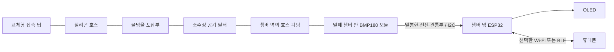

# BMP180 재사용 시제품 설계

2026-11-11. 보유 BMP180으로 화면·버튼·폰 그래프를 시험하기 위한 설계안입니다. 챔버 제작, 펌웨어 구현, 누설·응답·습기 시험은 아직 하지 않았습니다. 포트형 센서의 대체품으로 확정한 것은 아닙니다.

## 필요한 처리

BMP180 모듈을 작은 밀폐 챔버에 넣어 호스 압력을 전달하고, **온도 보정된 절대압에서 사용 직전에 측정한 대기압을 빼서** 상대압을 구합니다. 센서 자체를 개조하거나 금속 덮개를 떼지 않습니다.



차압센서의 P2와 달리, **BMP180 챔버에는 측정 중 대기에 열린 별도 구멍을 두지 않습니다.** 영점 조정 때는 입력 호스 끝을 입·코에서 분리해 대기에 개방합니다. 압력은 같은 호스를 통해 양방향으로 전달되므로 체크밸브를 기본 경로에 넣지 않습니다.

## 챔버 제작 제안

| 부분 | 처리 방법 | 확인할 점 |
|---|---|---|
| 본체·뚜껑 | 모듈이 들어갈 만큼 작은 단단한 용기와 가스켓/O링 뚜껑 | 방수 표시만으로 기밀성을 가정하지 않음. 손으로 누를 때 용기가 변형되면 측정값도 변할 수 있음 |
| 호스 입구 | 벽에 바브 피팅을 고정하고 가스켓으로 밀봉 | 호스 내경은 실제 피팅에 맞춤. 당김이 센서나 접착부에 직접 걸리지 않도록 고정 |
| 전선 출구 | 가는 전선을 통과시키는 부분만 밀봉 | 핀헤더 주변 틈, 전선 사이 틈, 뚜껑 접합부를 누설 시험 |
| 센서 고정 | 모듈 가장자리 지지, 통기구 주변은 비워 둠 | 센서 구멍에 접착제·실리콘·코팅제를 넣지 않음 |
| 열원 | ESP32·충전기·배터리는 챔버 밖에 배치 | 무선 켜짐/꺼짐과 충전에 따른 열 영향을 줄이고 실측 |
| 수분 | 센서보다 낮은 포집부와 교체 가능한 소수성 공기 필터 | 액체 유입 감소용. 수증기 통과와 내부 결로는 별도 문제 |

먼저 가스켓과 피팅으로 분해 가능한 구조를 만들고, 밀봉재가 필요하면 전자부품과 재질에 적합한 제품을 관통부에만 사용합니다. 완전히 경화한 후 조립·시험합니다. 통기구에 호스를 직접 접착하거나 모듈 전체를 수지로 덮는 방법은 제안하지 않습니다.

호스·필터·챔버의 공기 부피와 저항이 파형 및 사용감에 영향을 줄 수 있습니다. 큰 빈 공간을 줄이되, 통로를 지나치게 좁혀 피크를 늦추지 않도록 조립 상태로 확인합니다. 작은 용기만 확보하기 위해 센서 모듈을 절단하지 않습니다. 정확한 챔버 치수는 보유 모듈 실측 후 정합니다.

## 측정 범위와 계산

BMP180의 명시된 절대압 범위는 **300–1,100 hPa**입니다. `P0`를 호스가 대기에 열린 상태에서 측정한 현지 기압이라고 하면 다음과 같습니다. 기상 앱의 해면 보정 기압이나 고도 환산값은 사용하지 않습니다. [Bosch 데이터시트 rev.2.8, pp.2, 6, 11–15](https://www.mouser.com/datasheet/2/783/BST-BMP180-DS000-1509579.pdf)

```text
상대압(hPa) = 현재 온도 보정 압력(Pa) / 100 − P0(hPa)
상대압(kPa) = 상대압(hPa) / 10
양압 쪽 명시 범위 끝(hPa) = 1100 − P0(hPa)
```

| 측정한 P0 | 양압 쪽 명시 범위 끝 | 예시 해석 |
|---:|---:|---|
| 1,000 hPa | +100 hPa / +10.0 kPa | 정확히 범위 끝까지 쓴 계산으로 오차 여유 없음 |
| 1,013 hPa | +87 hPa / +8.7 kPa | ±10 kPa 기기를 이 센서로 대체할 수 없음 |
| 1,030 hPa | +70 hPa / +7.0 kPa | 대기압이 높아지면 양압 여유가 줄어듦 |

예를 들어 P0=1,013 hPa에서 현재 압력이 1,033 hPa이면 +20 hPa, 993 hPa이면 −20 hPa입니다. 음압 변화도 읽을 수 있지만 양쪽 범위가 대칭인 차압센서는 아닙니다. 이 값은 센서 계산 예시이며 사람의 목표압이나 안전 한계가 아닙니다.

명시 범위 밖에서 숫자가 반환되어도 유효 측정으로 취급하지 않습니다. 범위 끝에 가까워지면 경고하고, 초과 시 정상 피크값 대신 범위 초과 상태를 기록합니다. 경고 여유는 실제 교정 오차를 보고 정합니다. 소프트웨어 보정, 긴 호스, 작은 구멍으로 보장된 측정 범위를 넓힐 수는 없습니다. 대기로 새게 만들면 측정 대상과 파형 자체가 달라집니다.

## 전기 연결과 펌웨어 제안

- 3.3 V 구동에 맞는 BMP180 모듈을 사용하고 I²C 풀업도 3.3 V로 유지합니다. 모듈의 VCC/VIN 표기와 레귤레이터 회로를 먼저 확인합니다. 센서 칩의 동작 전압은 1.8–3.6 V입니다.
- BMP180의 7비트 I²C 주소는 `0x77`입니다. 현재 보드 문서의 OLED는 `0x3C`, SDA GPIO5 / SCL GPIO6이므로 해당 보드가 맞으면 버스를 공유할 수 있습니다. 추가 풀업의 합성 저항과 선 길이를 확인하고 I²C 탐색으로 검증합니다. [현재 보드 문서](../esp32c3mini-oled0.42-72x40/README.md)
- 보정 계수와 온도 보정을 적용하는 BMP180 드라이버의 압력값을 사용합니다. 원시 ADC 값에서 대기압을 빼지 않습니다.
- 초기 취득 목표는 **25–50 Hz, OSS=1 또는 2**입니다. 압력 변환 최대시간은 각각 7.5 / 13.5 ms이며, OSS=3은 25.5 ms여서 50 Hz 설정에 맞지 않습니다. 이는 목표이며 웹 전송까지 포함한 실효 주기는 실측합니다.
- 온도는 최초 압력 읽기 전에 취득하고 이후 1 Hz부터 시험합니다. 온도 변화가 크면 갱신 주기와 오차를 함께 점검합니다. [Bosch 데이터시트 pp.9–15, 20–21](https://www.mouser.com/datasheet/2/783/BST-BMP180-DS000-1509579.pdf)
- 전원을 켜고 값이 안정된 뒤, 호스 개방 상태에서 1–2초 평균으로 P0를 저장합니다. 측정 중 자동으로 영점을 따라가면 유지한 압력이 사라지므로 영점을 고정합니다.
- 환경·높이가 바뀌거나 오래 사용한 뒤에는 다시 대기에 열고 영점을 맞춥니다. 센서 하나로 시작 기압을 빼는 방식은 측정 중 변하는 외부 기압을 실시간 제거하지 못합니다.
- 원본·표시용 평활화 값, 시간, 순번, P0, 오류 상태를 구분합니다. 센서 오류를 0 hPa로 바꾸지 않습니다. OLED·폰 갱신과 압력 취득을 분리합니다.

## 비용과 다음 판단

BMP180의 추가 구매비는 없지만 챔버·피팅·밀봉·필터 제작비가 듭니다. 이미 작은 용기와 호스를 가지고 있다면 초기 파형 시험에 유리합니다. 밀폐 구조를 새로 주문해야 한다면 포트형 센서까지 포함한 전체 비용을 비교합니다.

1. 먼저 건조 공기와 기준 압력계로 영점·양압·음압·복귀값을 비교합니다. 센서 범위 안의 낮은 압력부터 단계적으로 시험합니다.
2. 압력을 만든 뒤 시험용 공기 경로를 차단하여 누설에 따른 감소와 초기 온도 변화에 따른 감소를 구별합니다. 손으로 챔버를 누르지 않습니다.
3. 최종 호스와 필터를 붙인 상태에서 반복 피크·지연·영점 복귀를 비교합니다. Wi-Fi ON/OFF 상태도 확인합니다.
4. 포집부를 관리하면서 반복 습기 노출 뒤 영점·감도 변화와 결로 여부를 확인합니다. 필터만으로 방습이 완성됐다고 판단하지 않습니다.
5. 양압 상한에 접근하거나 습기·누설 문제가 반복되면 포트형 센서로 전환합니다. 화면·버튼·[로컬 웹 화면](web-connectivity.md)은 재사용하도록 센서 드라이버를 분리합니다.

현재 권고는 **BMP180으로 낮은 비용의 시제품을 먼저 시험하되, 휴대 완성품의 측정 범위와 내구성을 검증 후 결정**하는 것입니다.
