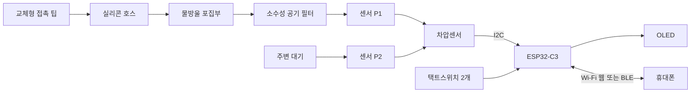
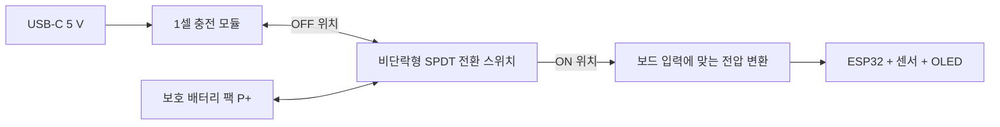
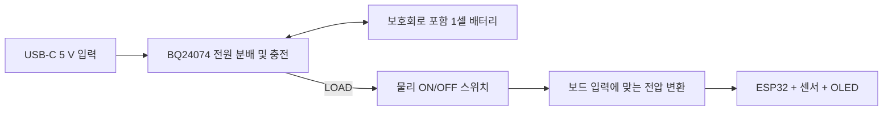

# 동작 및 연결 설계안

2026-11-11 기준 제안입니다. 아래는 기능 블록도이며 실제 핀 번호를 확정한 배선도나 검증된 회로가 아닙니다. 부품 사양 근거는 [하드웨어 조사](hardware-research.md)에 있습니다.

## 공기압과 데이터 경로

P2를 막거나 밀폐 케이스 내부 압력을 그대로 기준압으로 쓰지 않습니다. 케이스 기준압 통로는 외기와 통하게 설계합니다. 압력 입력은 공기 경로로 전달하며, 전자부는 호스의 액체 유입과 분리합니다.

위 그림은 두 포트 차압센서용입니다. [BMP180 시제품](bmp180-prototype.md)은 대기에 통하는 P2 없이 입력 호스만 연결한 밀폐 챔버를 사용하고 시작 기압을 뺍니다.

## 화면과 택트스위치

기존 72×40 화면에는 현재 압력, 최대값, 연결 상태 위주의 화면을 제안합니다. 상세 파형을 기기에서 직접 보려면 더 큰 화면이 편리합니다.

설정에 `폰 연결` ON/OFF와 접속 안내 화면을 추가합니다. 화면 QR은 작은 픽셀·물리 크기 때문에 스캔 검증이 필요하고 SSID/암호/IP 표시 및 케이스 QR 스티커로 보완합니다. [접속 흐름과 QR 제약](web-connectivity.md)

| 조작 | 기본 화면에서 | 설정 화면에서 |
|---|---|---|
| A 짧게 | 숫자 → 파형 → 세션 요약 순환 | 다음 항목 |
| A 길게 | 설정 진입 | 설정 종료 |
| B 짧게 | 기록 시작/종료 | 값 변경/선택 |
| B 길게 | 영점 조정 화면 진입 | 선택 확정 |

기기 전원은 별도 온오프 스위치가 담당합니다. 순간동작 택트스위치는 눌렀다 놓으면 복귀하므로 지속적으로 전원을 연결/차단하는 스위치와 구분합니다.

영점 조정은 호스를 대기에 개방한 상태에서 수행하도록 안내합니다. 눌린 압력을 자동으로 영점으로 삼지 않습니다. 버튼 입력은 디바운싱하고 길게 누르기와 짧게 누르기가 동시에 발생하지 않도록 구현합니다. 설정은 변경 확정 시 저장합니다.

버튼 1개로 줄일 경우 짧게=화면 전환, 길게=선택, 더 길게=설정 종료 등으로 구성할 수 있지만 수치 설정은 2개가 편리합니다. 버튼 GPIO는 보드의 OLED, USB, 부트 스트랩 기능과 충돌하지 않도록 확정합니다.

## 데이터 처리와 폰 표시

아래 수치는 구현 시작점이며 성능 측정 결과가 아닙니다.

- 센서 취득: XGZP6897D 등은 50–100 Hz, BMP180 시제품은 OSS=1/2에서 25–50 Hz 목표. HX710B는 최대 40 SPS로 별도 설정. 실제 변환 주기·필터 설정에 맞춰 조정.
- OLED 갱신: 10–20 Hz 정도에서 시작.
- Wi-Fi WebSocket 또는 BLE 전송: 여러 측정값을 묶어 10–20회/초 전송하는 방안 검토. 초기 웹 모드에서는 BLE를 동시에 사용하지 않음.
- 각 측정값에 장치 시간과 순번을 포함. 화면 갱신 속도와 센서 취득 속도를 분리.
- 원본 데이터와 표시용 평활화 데이터를 구분하여 짧은 피크를 과도한 필터로 지우지 않음.
- 측정 범위 초과, 센서 통신 실패, 무선 연결 끊김을 정상값으로 표시하지 않음.

1차 폰 기능은 현재 압력, 시간 그래프, 최대값, 유지시간, 기록 시작/종료, CSV 내보내기입니다. 기기와 폰에서 동시에 기록 명령이 들어오면 상태를 동기화합니다. 연결 단절이나 브라우저 중단 시 기록 공백을 명시하고, 장치 버퍼/재전송을 구현하기 전에는 무손실 기록을 보장하지 않습니다.

기기 내부 압력만으로 이관이 실제로 열렸는지, 프렌젤/발살바를 정확히 수행했는지 확정할 수 없습니다. 처음에는 압력 변화와 반복성을 보여주는 도구로 설계하고 기법 판정은 구현 범위에 넣지 않습니다. 측정 상한을 훈련 목표나 안전 임계값으로 사용하지 않습니다.

## 충전과 온오프 스위치

### 비용 우선 기본안: ON 사용 / OFF 충전

충전 중 측정은 기본안에서 제외합니다. 보호회로가 포함된 배터리 팩의 출력을 **사용 경로 또는 충전 경로 중 하나에만 연결**하면 단순한 1셀 충전기를 사용할 수 있습니다. OFF에서 USB를 연결하면 충전되고, ON으로 전환하면 충전 경로가 분리됩니다.

이는 회로 제안입니다. 실제로는 스위치 공통 단자에 보호된 팩의 P+, OFF 단자에 충전기의 BAT+, ON 단자에 전압 변환기 입력을 연결하는 방식을 검토합니다. 음극은 보호된 팩의 P− 기준으로 공통 연결하며, 보호회로 앞의 셀 단자를 우회 연결하지 않습니다. 충전기와 부하가 전환 순간에도 동시에 연결되지 않는 break-before-make 방식과 충분한 DC 정격을 선택합니다. 배터리 미연결 상태의 충전기 동작도 해당 모듈 문서로 확인합니다.

| 충전용 USB | 스위치 | 기본안의 의도한 동작 |
|---|---|---|
| 없음 | OFF | 기기 전원 차단. 팩 보호회로·충전기의 미소 대기전류는 남을 수 있음 |
| 없음 | ON | 배터리로 사용 |
| 연결 | OFF | 기기 부하를 분리하고 충전 |
| 연결 | ON | 배터리로 사용. 배터리의 충전 경로는 분리 |

이 기본안에서 USB 보조배터리는 충전 전원으로 사용할 수 있습니다. 보드 USB로 직접 구동하는 시험은 외부 배터리 공급을 분리한 별도 구성에서 진행합니다. 프로그래밍용 USB가 기기를 우회 구동하거나 충전 상태의 배터리에 부하를 연결하지 않도록 실제 보드 회로를 확인해야 합니다. 검증 전 확정 배선도로 사용하지 않습니다.

### 확장안: 충전 중 사용을 지원하는 BQ24074

충전과 사용을 동시에 하려면 아래 전원 분배 구조를 검토합니다. **충전 모듈과 배터리는 계속 연결하고 기기 쪽 부하만 차단**하는 방식입니다. 비용 우선 기본안과 선택 관계이며 두 구조를 합치지 않습니다.

| USB | 전원 스위치 | 의도한 동작 |
|---|---|---|
| 없음 | OFF | 기기 정지. 충전/보호회로의 대기전류는 남음 |
| 없음 | ON | 배터리로 측정·표시·BLE 동작 |
| 연결 | OFF | 기기는 정지하고 배터리 충전 |
| 연결 | ON | USB로 기기 구동 및 남는 입력 전력으로 배터리 충전 |

이 표는 충전 모듈 USB를 기준으로 합니다. MCU 보드의 프로그래밍용 USB를 따로 연결하면 전원이 우회 공급될 수 있으므로, 해당 보드의 USB 역급전 방지와 스위치 우회 경로도 확인합니다. ON/OFF 스위치가 배터리와 충전회로까지 완전히 절연하는 것은 아닙니다.

작은 슬라이드 스위치의 허용 DC 전류가 부하와 순간 전류에 충분하면 LOAD 선을 직접 차단할 수 있습니다. 신호용 소형 스위치만 사용한다면 레귤레이터 EN 또는 별도 로드스위치 IC를 제어합니다. 이 경우 OFF 누설전류와 다른 핀을 통한 우회전원까지 검증합니다.

최종 전압 변환은 두 가지를 비교합니다.

- **기존 보드 유지:** 회로상 허용되는 5 V 입력을 확인한 뒤 LOAD → 5 V 승압 → 보드 입력. USB 동시 연결 시 역급전 방지를 설계.
- **3.3 V 전원부 직접 설계:** LOAD → 3.3 V 승강압 → MCU/센서/OLED. 기존 보드의 레귤레이터 출력과 병렬 연결하지 않도록 회로 확인.

충전회로 내장 보드로 교체할 경우 위 외부 충전 모듈과 무조건 함께 사용하지 않습니다. 전원 구조 하나를 정하고, 중복 충전기나 충돌하는 공급 경로가 생기지 않게 합니다.

## 초기 부품 수량안

| 부품 | 수량 | 구매 전 확인 |
|---|---:|---|
| ESP32-C3 보드 | 1 | 보유품 재사용 가능 여부, 회로/핀맵 |
| 호스 포트형 I²C 압력센서 모듈 | 1 | 품번, 범위/부호, 전압, 세대/통신 규약 |
| OLED | 1 | 보유품 사용 또는 3.3 V 호환 모듈 |
| 순간동작 택트스위치 | 2 | 크기, 높이, 누름 감도 |
| ON/OFF 슬라이드 스위치 | 1 | DC 정격 또는 EN 제어 방식 |
| 보호회로 포함 1셀 배터리 | 1 | 4.2 V 충전 종지, 허용 충방전 전류, 극성 |
| 1셀 충전 모듈 | 1 | 기본안은 TP4056 계열·경로 전환. 동시 충전/사용 필요 시 전원 분배형으로 변경 |
| 전압 변환 모듈 | 1 | 최저 배터리 전압에서의 출력 전류, OFF 동작 |
| 호스/팁/포집부/필터/피팅 | 1세트 | 내경, 결합, 누설, 응답, 세척/교체 방식 |
| 케이스/고정재/배선 | 1세트 | 기준압 통로, 호스 당김 방지, 배터리 고정 |

## 실물 검증 항목

1. 대기에 개방했을 때 영점과 시간·온도에 따른 변화를 기록.
2. 공기압 기준기와 여러 압력점에서 비교. 검증 전 사람의 입/코 압력을 교정 기준으로 사용하지 않음.
3. 최종 호스·필터를 사용해 누설과 피크 응답을 확인.
4. 양방향 센서는 양압/음압 부호 및 양쪽 끝의 포화 표시 확인.
5. 화면·버튼·BLE가 동작하는 동안 센서 취득 주기가 유지되는지 확인.
6. BLE 단절/재연결, 센서 분리, 저전압 상태에서 잘못된 정상값이 남지 않는지 확인.
7. 선택한 전원안의 네 가지 상태, 스위치 전환 순간, MCU USB 우회전원을 실제 회로에서 확인.
8. 충전전류, 충전 종료, 온도, ON/OFF 전류, 연속 사용시간을 실측.

육상 연습용 측정 도구로 계획합니다. 수중 사용·방수·의학적 진단 기능은 검증된 요구사항이 아닙니다.
