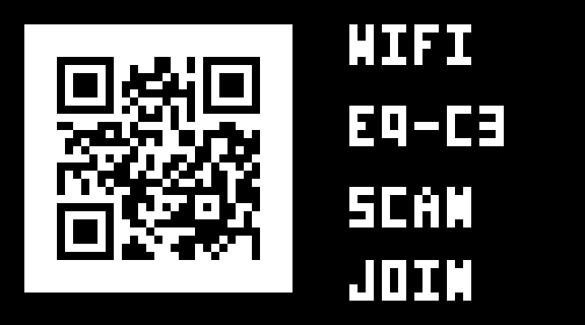
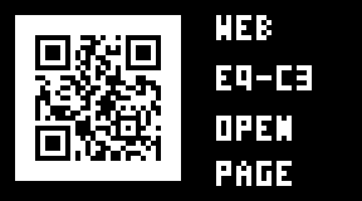

# ESP32-C3 Wi-Fi / OLED QR 실물 테스트

현재 보유한 ESP32-C3 mini와 SSD1306 72×40 OLED에서 휴대폰 연결을 시험하는 독립 펌웨어입니다. 압력센서·배터리 충전·BLE·택트스위치는 아직 구현하지 않았습니다. 보드의 기존 게임 대신 이 앱이 실행됩니다.

## 휴대폰 연결

1. OLED의 `WIFI` QR을 휴대폰 카메라로 읽어 연결합니다.
2. QR이 작아 읽히지 않으면 Wi-Fi 목록에서 **EQ-C3**, 암호 **eqtest32**로 직접 연결합니다.
3. 인터넷이 없다는 안내가 나와도 기기 Wi-Fi 연결을 유지합니다.
4. 연결 후 OLED는 `WEB` QR로 바뀝니다. 자동 안내 페이지가 안 뜨면 일반 브라우저에서 **http://192.168.4.1**을 엽니다.
5. 페이지의 켜진 시간과 응답 횟수가 증가하는지 확인합니다. `기기 OLED에 확인 표시`를 누르면 OLED에 `PHONE OK`가 5초간 표시됩니다.

Android Chrome에서 `ERR_TOO_MANY_RETRIES`가 나오면 **설정 → 앱 → Chrome → 권한 → 근처 기기/로컬 네트워크** 항목을 확인합니다. 이 실물 시험은 로컬 네트워크 권한을 허용한 뒤 웹 접속이 해결됐습니다. 항목 이름과 적용 여부는 Android·Chrome 버전에 따라 다릅니다. [공식 권한 설명](https://developer.android.com/privacy-and-security/local-network-permission)

암호는 이 테스트용 공개 값입니다. 제품용 펌웨어는 기기별 암호를 사용하도록 바꿔야 합니다. 접속 가능한 클라이언트는 최대 2대로 제한했습니다. 인터넷이나 외부 파일 다운로드가 필요 없는 페이지입니다.

QR은 네 면의 4모듈 여백을 포함하며 밝은 바탕에 어두운 모듈로 표시합니다. 두 QR 모두 실제 생성 결과 Version 2, 33×33픽셀입니다. 소프트웨어 디코딩과 작은 OLED를 휴대폰 카메라로 읽는 것은 별도의 검증입니다.

## 보드와 빌드

- Arduino ESP32 core 3.1.1, `esp32:esp32:esp32c3:CDCOnBoot=cdc,FlashSize=4M`.
- I²C: SDA GPIO5 / SCL GPIO6, OLED 0x3C(없으면 0x3D 탐색).
- 화면: 72×40, SSD1306 메모리 열 28–99, 페이지 0–4.
- 추가 Arduino 라이브러리 설치 없이 core의 Wire/WiFi/WebServer/DNSServer 사용.
- QR 비트맵은 저장소에 포함되어 있어 보드에서 QR 라이브러리를 실행하지 않습니다.
- Wi-Fi: 2.4 GHz 채널 6, 20 MHz 대역폭, 송신 출력 상한 11 dBm. 현재 보드에서 폰 연결과 연속 웹 요청이 확인된 설정이며 모든 보드에 대한 최적값은 아닙니다.

`equalization-tool/`에서 실행:

```powershell
./tools/build_web_test.ps1
```

CLI 또는 Arduino 데이터 경로가 다르면 `-ArduinoCli`, `-ArduinoData`를 지정합니다. Python 보조 도구는 `esptool>=5,<6`, `pyserial`, `Pillow`, `qrcode`, `zxing-cpp`를 사용합니다. QR 문자열 변경 시 `python tools/generate_qr.py`로 헤더를 다시 만듭니다.

## 백업·업로드·복구

먼저 보드에 연결된 컨트롤러/시리얼 모니터를 종료하고 필요한 게임 저장을 마칩니다. 아래 COM4와 백업 파일명은 실제 대상에 맞춥니다. 백업은 4 MiB 전체를 읽고 블록마다 장치가 계산한 MD5를 비교합니다. 플래시에는 설정이 들어 있을 수 있어 백업은 공개 저장소에 올리지 않습니다.

```powershell
python tools/backup_device.py --port COM4 --output output/pre-web.bin
python tools/flash_web_test.py --port COM4 --backup output/pre-web.bin
python tools/verify_web_device.py --port COM4
```

업로드 도구는 백업 SHA-256, 동일 포트, 빌드와 백업의 파티션 일치, 앱 크기를 검사한 뒤 **0x10000의 앱만** 씁니다. 이 저장소 보드의 1 MiB factory 파티션이 있는 경우에만 진행하며 NVS·부트로더·파티션 표·WAD는 직접 덮어쓰지 않습니다. 다른 보드에서 파티션을 자동으로 변경하지 않습니다.

전체 원상 복구가 필요할 때만, 해당 보드에서 만든 백업으로 복구합니다. 이는 백업 이후 설정도 당시 상태로 되돌립니다.

```powershell
python -m esptool --chip esp32c3 --port COM4 write-flash 0x0 output/pre-web.bin
```

## 검증의 범위

2026-11-11 COM4 보드 업로드 완료. 빌드 보고 앱 사용량 1,011,936바이트, 업로드 이미지 1,012,048바이트로 1 MiB factory 영역 안에 들어갑니다. 쓰기 후 esptool 해시 검증을 통과했습니다. AP/IP/OLED, QR 두 종류 디코딩, 내부 HTTP 검증도 통과했습니다. Android Chrome에서는 로컬 네트워크 권한 허용 후 웹 접속이 해결됐고, 보드에서 클라이언트 1대와 초당 웹 요청 증가를 확인했습니다. [검증 JSON](../../verification/web-qr-test.json), [폰 연결 기록](../../verification/phone-connection.json)

아래는 보드에서 읽은 OLED 프레임버퍼를 확대해 표시한 이미지입니다. 화면 사진이나 카메라 인식 검증 결과는 아닙니다.




`verify_web_device.py`는 장치의 AP/IP/OLED 응답, 두 OLED 프레임버퍼의 QR 디코딩, 장치 내부 TCP 루프백을 통한 `/api/status` HTTP 응답을 검사합니다. 실제 무선 웹 접속과 폰 버튼을 눌렀을 때 OLED의 `PHONE OK` 표시는 사용자가 따로 확인했습니다. 휴대폰 카메라 인식과 포털 자동 열림은 아직 확인하지 않았습니다. 압력값이나 모의 압력 그래프는 표시하지 않습니다.

USB 진단 명령은 `STATUS`, `FRAME`, `WIFI`, `URL`, `AUTO`, `HTTPTEST`, `POWER 2..19`, `CHANNEL 1..11`, `SCAN`입니다. `WIFI`/`URL`은 화면을 강제 선택하고 `AUTO`는 폰 연결 여부에 따른 자동 전환으로 복귀합니다. `POWER` 단위는 dBm, 상태의 `tx_power_qdbm` 단위는 0.25 dBm입니다. 출력·채널 변경은 재부팅 시 기본값으로 돌아갑니다. `SCAN`은 일시적으로 AP+STA 모드에서 주변 네트워크 개수만 읽고 AP 모드로 복귀하므로 연결 중에는 피합니다. HTTP API는 `/api/status` GET과 `/api/display` POST입니다.

```powershell
python tools/serial_diagnostics.py --port COM4 --command STATUS --seconds 8
python tools/scan_windows_wifi.py --output output/windows-scan.json
```

초기에는 폰에서 SSID가 보이지 않았고, 출력·채널을 조정한 뒤 폰 연결을 확인했습니다. 여러 설정을 함께 바꿨으므로 한 설정만을 원인이나 해결책으로 확정하지 않습니다. PC의 WLAN 검색에는 폰 연결 이후에도 SSID가 나타나지 않아, 이 PC 검색 결과만으로 AP 송출 실패를 판정하지 않습니다.
