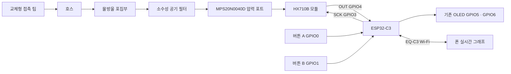

# HX710B 이퀄툴 부품과 연결

2026-11-11. 사용자와 확정한 핀 배치입니다. 보유 ESP32-C3 + 72×40 OLED를 재사용합니다. 센서와 외부 버튼은 아직 연결 전이므로 아래 배선은 실제 연결 후 검증해야 합니다.

## USB 전원으로 먼저 만드는 구성

| 부품 | 수량 | 선정 조건 |
|---|---:|---|
| 현재 ESP32-C3 + 0.42인치 OLED | 1 | 보유품 사용. OLED는 GPIO5/6에 연결된 상태 |
| MPS20N0040D + HX710B 모듈 | 1 | 사용자 지정 Reddit 모듈과 같은 계열. **3.3 V 동작을 지원하는 완성 모듈**인지 판매 사양 확인. HX710B IC만 또는 압력센서만 구매하지 않음 |
| 순간동작 NO 택트스위치 | 2 | 2핀 또는 4핀, 크기·높이는 케이스에 맞춤 |
| 연결선, 핀헤더, 만능기판 | 1세트 | 시제품은 짧은 점퍼선, 휴대용은 납땜/커넥터와 당김 방지 |
| 100 nF 세라믹 + 10 µF 커패시터 | 각 1 | 모듈에 이미 충분히 실장돼 있으면 추가 불필요. 센서 VCC–GND 가까이에 병렬 배치, 전해는 극성 확인 |
| 실리콘 호스, 접촉 팁, 피팅 | 1세트 | 실제 센서 포트 외경에 맞는 호스 내경 선택. 상품명만으로 2/3 mm를 확정하지 않음 |
| 물방울 포집부 + 소수성 공기 필터 | 각 1 | 건조 공기만 센서로 전달. 필터 저항·응답 지연은 완성 경로에서 확인 |
| USB 데이터 케이블, USB 5 V 전원 | 1 | 기존 PC 또는 보조배터리 사용 |
| 기준 압력계 / 마노미터 | 1대 사용 | 영점 외에 실제 kPa 교정에 필요. 빌리거나 기존 장비를 사용해도 됨 |

OLED와 별도 통신 모듈은 추가 구매할 필요가 없습니다. HX710B 자체 공급 범위는 2.6–5.5 V지만 **모듈 전체와 압력센서의 보증 범위가 동일하다는 뜻은 아닙니다**. MPS20N0040D-S 문서는 5 V 조건을 제시합니다. 이번 배선은 3.3 V 호환 모듈을 전제로 하며, 3.3 V에서 RAW 변화·노이즈·교정·포화를 실측합니다. 5 V 전용 모듈의 OUT을 ESP32에 직결하지 마세요. [AVIA HX710 데이터시트](https://www.hestore.eu/en/prod_getfile.php?id=16147), [MPS20N0040D-S 참고 문서](https://cdn.sparkfun.com/assets/home_page_posts/1/9/0/2/Pressure_Sensor.pdf)

## 센서와 버튼 배선

**전원을 뺀 상태에서 연결합니다. 숫자는 헤더의 물리 위치가 아니라 GPIO 번호입니다. 모듈 핀 배열은 제품마다 다르므로 인쇄된 이름으로 연결합니다.**

| 대상 단자 | ESP32-C3 연결 | 설명 |
|---|---|---|
| HX710B `VCC` | `3V3` | 위의 3.3 V 호환 조건 적용 |
| HX710B `GND` | `GND` | 공통 접지 |
| HX710B `OUT` / `DOUT` / `DT` | **GPIO4** | ADC 데이터 출력 → ESP 입력 |
| HX710B `SCK` / `CLK` | **GPIO3** | ESP 클럭 출력 → ADC 입력 |
| 버튼 A 한쪽 | **GPIO0** | 내부 풀업, 누르면 LOW |
| 버튼 A 반대쪽 | `GND` | 순간 접점 |
| 버튼 B 한쪽 | **GPIO1** | 내부 풀업, 누르면 LOW |
| 버튼 B 반대쪽 | `GND` | 순간 접점 |
| 기존 OLED SDA / SCL | GPIO5 / GPIO6 | 기존 연결 유지, 새 배선 불필요 |

```text
ESP32-C3                         HX710B 압력 모듈
  3V3 -------------------------- VCC
  GND -------------------------- GND
  GPIO4 <----------------------- OUT / DOUT
  GPIO3 -----------------------> SCK / CLK

  GPIO0 -------- [버튼 A, NO] --- GND
  GPIO1 -------- [버튼 B, NO] --- GND

  GPIO5 / GPIO6 ---------------- 기존 OLED SDA / SCL
  USB-C <----------------------- USB 5 V 전원
```

4핀 택트스위치는 내부에서 이미 연결된 다리 두 개씩으로 나뉩니다. 멀티미터로 **평상시에는 끊기고 누를 때만 이어지는 두 단자**를 골라 GPIO와 GND에 연결하세요. 이미 연결된 두 다리를 고르면 항상 눌린 상태가 됩니다. 외부 풀업 저항은 기본 구성에서 필요 없습니다. 펌웨어에 30 ms 디바운스와 800 ms 길게 누르기를 적용했습니다.

GPIO2/8/9의 부팅 설정, GPIO18/19의 USB, 내장 플래시 및 기존 OLED 핀과 겹치지 않도록 0/1/3/4를 선택했습니다. GPIO4를 사용하므로 별도의 외부 JTAG 배선과 함께 쓰지 않습니다. [ESP32-C3 데이터시트](https://www.espressif.com/sites/default/files/documentation/esp32-c3_datasheet_en.pdf)



센서의 기준압 통로를 접착제나 밀폐 케이스로 막지 않습니다. 포집부는 센서보다 낮게 배치하고 포트에 호스의 당김이 걸리지 않게 고정합니다. 소수성 필터는 수증기까지 제거하지 않으므로 결로는 별도로 확인해야 합니다.

## 충전식 휴대용으로 추가할 부품

가장 먼저 USB로 센서 동작을 확인한 뒤 아래 전원부를 추가합니다. 사용자 요구에 따라 **충전 중에도 측정 가능한 전원 분배형 충전기**를 기본으로 변경했습니다. **ON=사용하면서 충전 가능, OFF=기기만 꺼지고 충전 가능**입니다. 실제 배터리·전원 모듈 조합은 조립 검증 전입니다.

### 우선 후보: 충전 + 5 V 승압 통합 보드

비용과 배선을 줄이는 후보는 **[Adafruit BQ25185 + 5 V Boost #6106](https://www.adafruit.com/product/6106)**입니다. 2026-11-11 제조사 표시가 **US$8.95**, 배송·세금 제외입니다. BQ25185 전원 분배 충전기와 TPS61023 승압기가 한 보드에 있어 별도 승압기를 구매하지 않아도 됩니다. BQ25185 충전기만 있는 #6091이나 3.3 V 출력 버전과 구분하세요.

| 부품 | 수량 | 이번 구성의 조건 |
|---|---:|---|
| BQ25185 + 5 V Boost 통합 모듈 #6106 | 1 | 5 V 출력 최대 1 A의 제조사 사양. 보유 C3의 시작·Wi-Fi 순간 부하에서 실측 필요 |
| 보호회로 포함 1셀 3.7 V 배터리 | 1 | 약 1,000 mAh 후보, **500 mA 충전을 허용하는 팩**. 커넥터 극성 확인 |
| 유지형 ON/OFF 슬라이드 스위치 | 1 | EN–GND 신호 제어용. 접점이 닫히는 위치를 OFF로 배치 |
| 출력 USB 전원 케이블/커넥터, 케이스 | 1세트 | 모듈 5 V/GND를 보드 USB-C 입력으로 전달 |

```text
충전용 USB 5 V ─────────── 통합 모듈 USB-C
보호 배터리 팩 P+ / P− ── 통합 모듈 BATT + / −
통합 모듈 5V / G ──────── 보드 USB-C 전원 입력

통합 모듈 EN ── [유지형 스위치] ── G
                  닫힘 = OFF / 열림 = ON
```

모듈 EN을 GND로 내리면 5 V 출력이 꺼지고 충전기는 계속 동작합니다. TPS61023은 shutdown 시 입력과 출력을 분리하는 기능을 제공합니다. 배터리 보호회로와 충전기 자체의 대기전류는 남습니다. [모듈 핀 안내](https://learn.adafruit.com/adafruit-bq25185-usb-dc-solar-charger-with-5v-boost-board/pinouts), [TI TPS61023](https://www.ti.com/product/TPS61023)

**#6106의 기본 충전전류는 1 A**입니다. 이 가이드의 500 mA 허용 팩을 사용한다면 제조사 지침에 따라 충전전류 점퍼를 변경해 500 mA로 낮춥니다. 500 mA를 허용하지 않는 작은 팩에는 그대로 적용하지 말고 전류를 더 낮출 수 있는 다른 구성을 선택합니다. 이 모듈은 연속 충전 6시간 타임아웃이 있으므로 큰 팩/약한 입력 전원 조합에서 충전 완료도 확인합니다. 제조사는 200 mA를 넘는 즉시 부하에서 승압기 기동 제약을 안내하므로 실제 C3로 냉간 기동과 USB 탈착을 검증해야 합니다. [제조사 설정·기동 조건](https://learn.adafruit.com/adafruit-bq25185-usb-dc-solar-charger-with-5v-boost-board/pinouts)

### 대안: BQ24074 + 별도 승압기

더 낮은 충전전류 설정이나 배터리 NTC 연결이 필요하면 아래 분리 구성을 검토합니다. **위 통합 구성과 둘 중 하나만 사용**합니다.

| 추가 부품 | 수량 | 조건 |
|---|---:|---|
| 보호회로 포함 1셀 Li-ion/LiPo 팩 | 1 | 정격 3.7 V, 완충 4.2 V, 약 1,000 mAh 후보. 셀·팩의 허용 충전 전류 확인 |
| 전원 분배형 1셀 충전 모듈 | 1 | **BQ24074**, BAT와 OUT/LOAD가 분리된 제품. 초기 충전전류 200 mA 후보, 배터리 허용치 우선. 일반 TP4056 단독 구성은 제외 |
| 5 V 승압 모듈 | 1 | 배터리 최저 전압에서도 실제 출력 500 mA 이상을 설계 목표로 검증. USB 5 V 출력 형태가 편리함 |
| SPST ON/OFF 슬라이드 스위치 | 1 | LOAD→승압기 사이 차단. 해당 위치 최대 전류를 견디는 DC 정격, 초기 1 A 이상 후보. SPDT는 COM과 한쪽 접점만 사용 가능 |
| 배터리 커넥터, 절연재, 케이스 | 1세트 | 역극성 방지, 셀 고정, 배선 눌림 방지 |

```text
USB 5 V ─────────────── BQ24074 USB 입력
보호 배터리 팩 P+ ────── BQ24074 BAT / LIPO
보호 배터리 팩 P− ────── GND
BQ24074 OUT / LOAD ──── ON/OFF 스위치 ─── 승압기 VIN+
BQ24074 GND ──────────────────────────── 승압기 VIN−
승압기 USB 5 V 출력 ───────────────────── 보드 USB-C
```

이 구성은 **보호회로 포함 팩의 외부 P+/P− 두 선**을 사용합니다. 배터리는 충전기에 계속 연결하고 부하만 끕니다. BQ24074의 OUT은 충전기 시스템 출력이며 배터리 BAT와 같은 단자가 아닙니다. USB가 없으면 배터리에서, USB가 있으면 입력 전원에서 부하를 공급하면서 배터리를 충전하도록 관리합니다. 입력 전력이 부족하면 충전전류를 줄이거나 배터리가 부하를 보조할 수 있어 USB를 꽂았다고 항상 충전량이 증가하는 것은 아닙니다. [TI BQ24074](https://www.ti.com/product/BQ24074)

기준 모듈 예시는 [Adafruit BQ24074 #4755](https://www.adafruit.com/product/4755)입니다. 2026-11-11 웹 표시 US$14.95, 배송·세금 제외입니다. 저렴한 호환 모듈도 가능하지만 회로·출력 핀·충전전류·입력 전류 제한을 확인해야 합니다. OUT은 배터리 전압 부근~최대 4.4 V이므로 **5 V 정전압 승압기**를 거칩니다. 기본 1 A 충전 설정은 작은 팩에 그대로 쓰지 않고 ISET 설정으로 낮춥니다. 배터리 온도를 감시하려면 문서에 맞는 10 kΩ NTC를 THERM에 연결합니다. [제조사 핀/설정 설명](https://learn.adafruit.com/adafruit-bq24074-universal-usb-dc-solar-charger-breakout/pinouts)

충전 입력은 적절한 USB 5 V 전원을 사용하고 입력 전류 제한을 그 전원에 맞춥니다. 실제 Wi-Fi 부하와 충전전류 합계, 발열, USB를 꽂고 뺄 때 재부팅/측정값 변동을 확인합니다. 충전 중 노이즈가 압력 측정에 더해지는지도 같은 압력에서 비교합니다. 전원 전환은 충전 회로가 담당하므로 펌웨어의 별도 충전 제어는 필요하지 않습니다.

보드의 3V3 핀에 완충 4.2 V 배터리를 직접 연결하지 않습니다. PC로 업로드할 때에는 승압기의 USB 연결을 빼고 PC USB만 연결합니다. 이 방식은 정체가 확실하지 않은 보드의 5 V 핀에 두 전원을 병렬로 넣지 않고 USB 전원 경로를 이용합니다. 배터리 사용시간과 충전 발열은 완성 회로에서 측정해야 합니다.

## 첫 연결 순서

1. USB를 빼고 위 표대로 센서·버튼을 연결합니다. VCC/GND와 버튼 접점부터 확인합니다.
2. USB를 연결합니다. 기본 OLED는 그래프입니다. `NO SENSOR`가 계속 보이면 전원·OUT/SCK·모듈 호환성을 확인합니다.
3. 호스를 대기에 열고 **B 길게 → ZERO → B**로 영점을 맞춥니다. 약 80 samples를 수집합니다.
4. 최초에는 `UNCAL RAW`가 정상입니다. 기준 압력계와 함께 `CALIBRATE` 메뉴 또는 웹의 교정을 진행합니다.
5. 무압→기준압→무압을 반복하고 여러 압력점에서 오차·영점 복귀·누설·포화를 확인합니다.
6. 폰 연결은 **A → PHONE → B → WIFI QR → B**. QR 화면에서 A로 웹 주소 QR을 전환합니다. [전체 메뉴와 사용법](firmware/EqualizationTool/README.md)

0–40 kPa는 센서 계열의 명목 양압 범위이며 실제 모듈+ADC 조합이 끝까지 선형 측정된다는 보장은 없습니다. 정확한 음압 범위도 검증하지 않았습니다. 이 값은 사람에게 권장하는 훈련 압력이 아닙니다.
